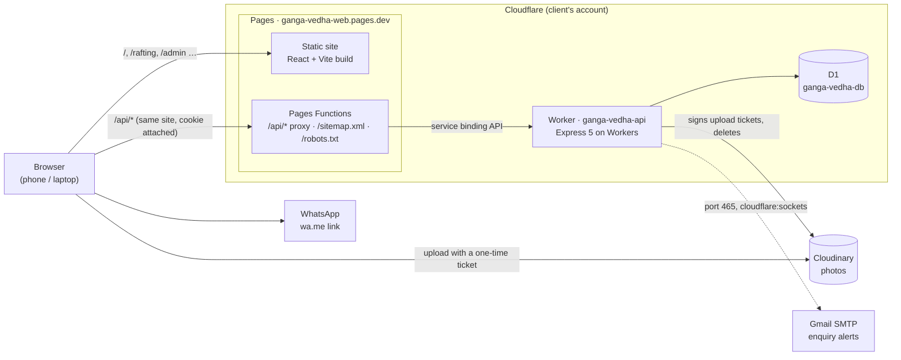
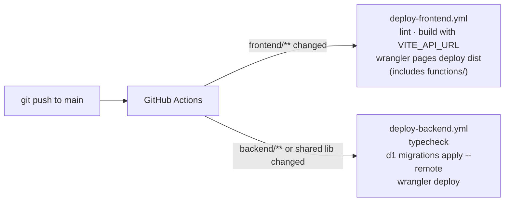

# Architecture

> The single source of truth for how Ganga Vedha is wired: addresses, request path, login,
> cookies, CORS, secrets, local dev and deploys.

**Precedence.** For anything about *how this project is wired* (the topics above), this file wins.
BLUEPRINT.md is the generic template these rules came from; AGENTS.md and GUIDE.md must agree with
this file. If you change the wiring, **update this file in the same commit**, and fix any doc that
now disagrees.

**Current state (2026-11-16):** rebuilt from the original Next.js 15 + Neon + Vercel app onto the
spasht.dev Cloudflare stack (branch `cloudflare-rebuild`).

- D1 `ganga-vedha-db` exists, its schema is migrated and it holds all Neon data as of 2026-11-16.
- The Pages project `ganga-vedha-web` exists.
- **The API Worker is not deployed yet**: the Cloudflare token lacks *Workers Scripts: Edit* (incident #12).
- The old Next.js app still sits at the repo root (`src/`, `next.config.ts`, root `package.json`) until the new site is live and checked (section 12).

---

## 01 System overview



| Piece | Address | Job |
|---|---|---|
| Website (Pages project `ganga-vedha-web`) | `https://ganga-vedha-web.pages.dev` | Public site, admin UI, **the `/api/*` reverse proxy**, `/sitemap.xml`, `/robots.txt` |
| API (Worker `ganga-vedha-api`) | reached through the Pages service binding `API`; its `workers.dev` URL is not used | Public content API, enquiries, admin login and admin functions. Browsers never call it directly. |
| Database (D1) | `ganga-vedha-db`, id `73b80766-7b44-4fc0-9dad-24725a3fc68b`, location APAC | All data |
| Photos | Cloudinary cloud `c5gjzsz1`, folders `ganga-vedha/<entity>` | Every image. **Not R2** (section 10). |
| Alert email | Gmail SMTP, the owner's address + app password | One email per new enquiry. Optional. |
| Account | the client's Cloudflare account (id in GitHub secret `CLOUDFLARE_ACCOUNT_ID`) | Pages, Worker and D1 all live here |

---

## 02 The one-address rule (why the proxy exists)

**The browser must only ever talk to one site.** The website calls the API at `/api/...` on its own
address; the Pages Function forwards it to the Worker inside Cloudflare.

Why: `pages.dev` and `workers.dev` are on the **Public Suffix List**, so `ganga-vedha-web.pages.dev`
and `…workers.dev` are two unrelated *sites* to a browser. A login cookie set by one is a third-party
cookie on the other. Safari (every iPhone browser), Brave and Chrome incognito block cross-site
cookies even with `SameSite=None`. **No server setting (CORS, `SITE_ORIGIN`) can change that; only
the address can.**

How the proxy reaches the Worker:

- **Service binding `API`** (`frontend/wrangler.jsonc`), which is a direct Worker-to-Worker call.
  No public URL is involved, and the Worker sees the visitor's real `cf-connecting-ip`.
- Fallback: a Pages variable `API_ORIGIN` holding the Worker's URL. With no binding and no
  `API_ORIGIN`, `/api/*` answers 503 "not connected yet".
- All of it is one file: `frontend/functions/_api.ts` (`forward()`), used by `functions/api/[[path]].ts`,
  `functions/sitemap.xml.ts` and nothing else.

What this means in practice:

- `VITE_API_URL` in production is `/`. Never the Worker URL.
- New API routes need nothing extra: `functions/api/[[path]].ts` forwards every `/api/*` path.
- The same holds on a custom domain later (section 09).

---

## 03 Login and sessions (decided)

| Part | Decision | Where |
|---|---|---|
| Proof of login | JWT (HS256, `jose`), 30 days, `sub` = admin id | `backend/src/lib/auth.ts` |
| Signing key | `JWT_SECRET`, ≥ 32 chars. The API **refuses to sign or verify** without it (503) | `auth.ts` `key()` |
| Passwords | `bcryptjs` cost 12; unknown email still runs a bcrypt compare (same timing, same error) | `routes/admin-auth.ts` |
| Transport | **HttpOnly cookie** `gv_session`, never localStorage, never an `Authorization` header | `auth.ts` `issueSession()` |
| Cookie in production | `HttpOnly; Secure; SameSite=None; Path=/; Max-Age=2592000` | same |
| Cookie on `http://localhost` / `127.0.0.1` | `HttpOnly; SameSite=Lax` (no `Secure`: Safari drops Secure cookies on plain http) | same |
| Logout everywhere | Tokens issued before `admin_users.updated_at` are rejected. Changing the password bumps it (whole seconds, like JWT `iat`) and re-issues this device's cookie. | `getVerifiedSession()`, `POST /api/admin/password` |
| Admin account | Single owner, **carried over from Neon** with its existing bcrypt hash: the owner logs in with the same email and password as before. There is no setup screen and no sign-up. | `admin_users` |
| Login rate limit | 10 attempts per 15 minutes per IP (keyed hash, D1 `rate_limits`) | `admin-auth.ts`, `lib/ratelimit.ts` |
| Every admin call | `requireAdmin` verifies the cookie itself on every `/api/admin/rpc/*` call. The SPA route guard (`app/admin/(dashboard)/layout.tsx` loader) is UX only. | `routes/admin-rpc.ts` |
| Login self-check | After a correct password the login form calls `/api/admin/me`; if the cookie was dropped it says so instead of looping | `frontend/src/lib/actions/auth.ts` |

**Why `SameSite=None` if the proxy makes it first-party?** It keeps Chrome working if anything ever
calls the Worker directly. It opens CSRF, which `originGuard` closes (next section). Once a custom
domain is live and everyone uses it, this may go back to `Lax` (section 09).

---

## 04 CORS and CSRF

| Guard | Rule | Where |
|---|---|---|
| CORS | `Access-Control-Allow-Origin` only for origins listed in `SITE_ORIGIN`, with credentials. **Never `*`.** | `backend/src/lib/http.ts` `cors` |
| CSRF (`originGuard`) | Any `POST/PUT/PATCH/DELETE` whose `Origin` header is present and **not** in `SITE_ORIGIN` → 403. Browsers always send `Origin` on cross-site writes and pages can't fake it. | `http.ts` `originGuard`, mounted before every route |
| Body parsing | Hand-written JSON parser, 256 KB cap (`express.json()` crashes workerd) | `http.ts` `jsonBody` |

`SITE_ORIGIN` today: production `https://ganga-vedha-web.pages.dev` (in `backend/wrangler.jsonc`);
local `http://localhost:5173,http://localhost:5174` (in `backend/.dev.vars`).
**Adding a new site address (custom domain, `www.`) means adding it here, or every save returns 403.**
Pages preview addresses (`<hash>.ganga-vedha-web.pages.dev`) are deliberately not allowed: they can
read, not write.

---

## 05 Configuration and secrets map

Every value, where it lives, and who reads it. Nothing else holds these.

| Value | Local (your machine) | Production | Read by | Secret? |
|---|---|---|---|---|
| `VITE_API_URL` | `frontend/.env.local` = `http://localhost:8787` (empty = static seed mode) | GitHub **variable** = `/` | Browser code (baked in at build) | No, public |
| `VITE_SITE_URL` | unset (uses the page's origin) | GitHub **variable**, the custom domain once there is one | Canonical / Open Graph URLs | No, public |
| `CLOUDFLARE_API_TOKEN` | `backend/.env` | GitHub **secret** | Wrangler, CI | **Yes** |
| `CLOUDFLARE_ACCOUNT_ID` | `backend/.env` | GitHub **secret** | Wrangler, CI | Private |
| `JWT_SECRET` | `backend/.dev.vars` | API Worker → Settings → Variables and Secrets → type **Secret** | The Worker | **Yes** |
| `CLOUDINARY_API_KEY`, `CLOUDINARY_API_SECRET` | `backend/.dev.vars` | API Worker, type **Secret** | The Worker (signing, deleting) | **Yes** |
| `SMTP_USER`, `SMTP_PASS`, `ENQUIRY_NOTIFY_TO` | `backend/.dev.vars` | API Worker, type **Secret** | The Worker (alert email) | **Yes** (`SMTP_PASS` is a Google app password) |
| `SITE_ORIGIN`, `SITE_URL` | `backend/.dev.vars` | `backend/wrangler.jsonc` → `vars` | The Worker (CORS + CSRF; links in emails) | No |
| `CLOUDINARY_CLOUD_NAME`, `SMTP_HOST`, `SMTP_PORT` | `backend/wrangler.jsonc` | same file | The Worker | No |
| D1 id | `backend/wrangler.jsonc` | same file | Wrangler | No |
| `API` service binding | n/a | `frontend/wrangler.jsonc` | Pages Functions | No |
| `API_ORIGIN` (optional) | not used | Pages project variable, only if the binding is removed | Pages Functions | No |

Rules learned the hard way:

- Worker secrets go on the **API Worker** (`ganga-vedha-api`), **never** on the website project
  (`ganga-vedha-web`), and as type **Secret** (`pnpm exec wrangler secret put NAME` in `backend/`).
  Plain-text Worker variables are **overwritten by the next deploy** from `wrangler.jsonc`; Secrets are kept.
- When the dashboard offers "update your Wrangler configuration" with a secret in it, **don't**.
  `wrangler.jsonc` is committed to git.
- Two env files on purpose: `.env` is for the Wrangler **tool** (account access); `.dev.vars` is for
  the **running API**. Merging them would hand the account token to the API code.
- Anything starting `VITE_` is public. A secret pasted into chat, an issue or a screenshot is leaked:
  roll it, then update it **everywhere** in the table above.

---

## 06 Data flow

**Public page view**
1. Browser loads the static site from Pages. Every page is its own lazily loaded chunk.
2. The route's `loader` calls `frontend/src/lib/content.ts` (`getHotels()`, `getPackage(slug)`, …),
   which calls `/api/<resource>` (proxy → Worker → D1). The API sends `Cache-Control: public, max-age=60,
   stale-while-revalidate=240` (closures: `max-age=30`), so an admin edit shows within a minute.
   `content.ts` also memoises each response for 60 s per tab, so moving between pages doesn't refetch.
3. With `VITE_API_URL` empty, `content.ts` loads `content.seed.ts` instead and the site shows a
   "Demo content" banner. A 404 from the API (unpublished or deleted slug) shows the not-found page.

**Customer enquiry**
1. The form is validated with the shared Zod schema (`frontend/src/lib/enquiry-schema.ts`), and WhatsApp opens with the details prefilled.
2. `POST /api/enquiries` validates again with the same schema and normalises the phone. It looks
   the product up server-side (never trusting a browser price) and snapshots its name and price.
   It refuses closed products, accepts the honeypot silently, and limits per phone (5 per 10 min)
   and per IP (20 per hour). A failed save never blocks WhatsApp.
3. The alert email is sent after the response, through `waitUntil` (`lib/email.ts` → `lib/smtp.ts`).
   A mail failure is logged and swallowed.

**Owner editing (admin)**
1. `POST /api/admin/login` → cookie `gv_session` (section 03).
2. Every admin read and write is `POST /api/admin/rpc/<module>.<function>` with `{ "args": [...] }`.
   - These are the original Next.js server actions (`backend/src/actions/*`) and admin reads
     (`backend/src/services/admin-data.ts`), ported unchanged in behaviour.
   - Only functions in the registry are reachable (`routes/admin-rpc.ts`). Each call runs
     `requireAdmin`, and `originGuard` covers CSRF.
   - The typed callers are `frontend/src/lib/actions/*.ts` and `frontend/src/lib/admin-data.ts`.
3. Photos: the admin asks the Worker for a one-time signed upload ticket (`media.getUploadTicket`),
   resizes the photo in the browser, then posts it straight to Cloudinary with that ticket. The
   Worker then records it (`media.createMediaRecord`). There is no unsigned upload preset.
4. Writes go to D1 and are recorded in `audit_log`. No rebuild, no redeploy.

**Code to production**



- The backend imports these files from `frontend/src/lib/`: `schemas/*`, `format.ts`, `closure.ts`,
  `hero-rooms.ts`, `why-us-icon-keys.ts`, `enquiry-schema.ts`, `content-types.ts`, `action-types.ts`
  and `media-types.ts`. Changing any of them redeploys the API too. They must use **relative imports
  only** and must not import React or lucide (the Worker bundles them).
- The frontend imports **types only** from `backend/src` (`lib/db-types.ts`, `lib/admin-data.ts`), so
  its typecheck needs `backend/node_modules`; both workflows install both folders.
- A frontend rebuild only happens when a file under `frontend/` changes, or from **Actions → Deploy
  Frontend → Run workflow**. Changing the `VITE_API_URL` variable alone does nothing until a rebuild.
- Migrations always run before the Worker deploy, in the same job. New migration: edit
  `backend/src/schema.ts`, then `pnpm db:generate` in `backend/`. Never edit an applied migration.

---

## 07 Local development (nothing offline)

```bash
# terminal 1: backend/
pnpm dev          # wrangler dev --remote: the API runs on Cloudflare, reachable at http://localhost:8787
# terminal 2: frontend/
pnpm dev          # Vite on :5173; frontend/.env.local has VITE_API_URL=http://localhost:8787
```

- **All data is real.** The D1 binding is `"remote": true`, and `pnpm dev` uses `--remote`.
  Anything done in the local admin changes production data. There is no offline copy, and none should
  be created: never `wrangler dev` without `--remote`, never `--local` on D1 commands.
- `wrangler dev --remote` needs a token with **Workers Scripts: Edit** (it uploads a preview Worker).
- `backend/.wrangler/tmp/` holds only the code bundle being uploaded; safe to delete.
- Stopping a stuck dev server: the process is `wrangler.js dev`, so `pkill -f "wrangler dev"` misses
  it. Use `lsof -iTCP:8787 -sTCP:LISTEN` and kill that PID, or `pkill -f wrangler`.
- UI only, no API: `VITE_API_URL= pnpm dev` in `frontend/` browses on the seed content.
- To test the proxy locally: `VITE_API_URL=/ pnpm build`, then `npx wrangler pages dev dist --port 8788`
  in `frontend/`. Cookies on `localhost` are shared across ports, so log out first for a clean test.

---

## 08 Incident log (from past builds; each one is now a rule above)

Add this project's incidents at the bottom. Never delete a row: it is why a rule exists.

| # | Symptom | Cause | Rule now |
|---|---|---|---|
| 1 | Correct password, then straight back to the login screen, no error | Site (`pages.dev`) and API (`workers.dev`) are two sites; the `Lax` cookie from a cross-site response was discarded | One-address rule + `/api` proxy (02) |
| 2 | Login on laptop Safari looped | `Secure` cookie on `http://localhost` is dropped by Safari | No `Secure` for `http://localhost` origins (03) |
| 3 | "Login is not set up on the server yet" | `JWT_SECRET` added to the website project, and as plain text | Secret on the API Worker, type Secret (05) |
| 4 | Dashboard suggested pasting the secret into `wrangler.jsonc` | Plain-text var on a Worker whose config doesn't list it | Use type Secret; never put secrets in `wrangler.jsonc` (05) |
| 5 | Local API lost its secret mid-session | Stale `wrangler dev --remote` after a preview-token refresh; `pkill` pattern missed it | Kill by port/PID (07) |
| 6 | "Is the live site connected?" checks said no | The API URL sits in a separate JS chunk, not `index-*.js` | Check the Network tab for `/api/` calls, not the main bundle |
| 7 | GitHub variable changed, site unchanged | Vite bakes `VITE_API_URL` in at build time | Re-run Deploy Frontend after changing it (06) |
| 8 | First-run setup screen reachable on the public API | Setup works while no admin exists | Create the owner account before the first deploy (03). Ganga Vedha has no setup screen at all. |
| 9 | (Pasha Travels) first backend deploy failed at `d1 migrations apply`: `[code: 7403] account not valid or not authorized` | GitHub secrets pointed at a different account than the one owning D1 | One account for Pages, Worker, D1; CI token created in that account |
| 10 | (Pasha Travels) after an oversized upload was refused, the next request failed with "Network connection lost" | The API threw halfway through an unread request body | Check `Content-Length` first, drain on overflow |
| 11 | (Pasha Travels) duplicate package slug gave a 500, not "already used" | Drizzle wraps the D1 `UNIQUE` error in `cause` | Walk the cause chain, answer 409 with a field error (`http.ts`) |
| 12 | (Ganga Vedha, 2026-11-16) `wrangler deploy` → "No access to the specified resource" on `…/scripts/ganga-vedha-api/secrets`; `wrangler dev --remote` → "edge-preview failed" | The account API token had D1 and Pages edit but only **read** on Workers Scripts | Token needs **Workers Scripts: Edit, D1: Edit, Cloudflare Pages: Edit** (`backend/.env.example`) |
| 13 | (Ganga Vedha migration) Postgres-only SQL would have failed on D1 | `count(*) filter (…)`, `now() - interval`, jsonb `@>`, `num_nonnulls`, `~` regex in the Neon schema and queries | SQLite equivalents: `sum(case …)`, ISO-string comparisons with `strftime`, `json_each`, `(x IS NOT NULL) + …`, `GLOB` (`backend/src/schema.ts`, `services/admin-data.ts`) |

---

## 09 Moving to a custom domain

With `VITE_API_URL=/`, the proxy works unchanged on any address.

1. Add the domain to the client's Cloudflare account (Cloudflare Registrar, or move nameservers).
2. **Workers & Pages → `ganga-vedha-web` → Custom domains**: add `<client-domain>` and
   `www.<client-domain>`.
3. `backend/wrangler.jsonc`:
   - `SITE_ORIGIN` = `https://<client-domain>,https://www.<client-domain>,https://ganga-vedha-web.pages.dev`
   - `SITE_URL` = `https://<client-domain>`

   Then push. **Skip this and every admin save returns 403.**
4. GitHub variable `VITE_SITE_URL` = `https://<client-domain>`, then re-run Deploy Frontend
   (canonical and Open Graph URLs).
5. Keep `VITE_API_URL=/`. Nothing to rebuild for the proxy.
6. Optional: redirect `pages.dev` → the domain; then the cookie can go back to `SameSite=Lax`
   (keep `originGuard`).
7. Submit `https://<client-domain>/sitemap.xml` in Search Console. Both the sitemap and `robots.txt`
   already use whichever address they are requested on.

---

## 10 Tech stack

| Area | Choice |
|---|---|
| Frontend | React 19.2, Vite 8, TypeScript, react-router-dom 7 data router (`createBrowserRouter`, a lazy chunk + `loader` per page), Tailwind v4, Archivo variable font (self-hosted via `@fontsource-variable`) |
| Head tags | React 19's built-in `<title>`/`<meta>` hoisting: each loader returns `metadata`, `components/seo.tsx` renders it |
| Forms & validation | The original controlled forms with `useActionState`; Zod v4 schemas in `frontend/src/lib/schemas/`, validated again by the API |
| Backend | Express 5 on Cloudflare Workers (`nodejs_compat`, `httpServerHandler`) |
| Admin API | One RPC endpoint per admin function (`/api/admin/rpc/<module>.<fn>`), a registry of the ported server actions |
| Reverse proxy | Pages Functions (`frontend/functions/`) over the `API` service binding |
| Database | Cloudflare D1 + Drizzle ORM (`sqlite-core`), migrations generated by drizzle-kit into `backend/migrations/` and applied by Wrangler |
| Photos | **Cloudinary**, signed one-time upload tickets from the Worker; delivery via Cloudinary transforms (`components/image.tsx` builds the srcset) |
| Email | Gmail SMTP over `cloudflare:sockets` (`backend/src/lib/smtp.ts`); no third-party mail service |
| Auth | jose JWT in an HttpOnly cookie, bcryptjs, single owner account |
| Deployment | GitHub Actions: `deploy-frontend.yml` (Pages), `deploy-backend.yml` (migrations + Worker) |
| Tooling | pnpm 10, Node 22, oxlint, `tsc` |

**Deliberate differences from BLUEPRINT.md, and why:**

- **Cloudinary instead of R2.** All 111 existing photos and every stored URL were already on
  Cloudinary, and Cloudinary resizes and converts formats per browser, which R2 doesn't. The
  Worker keeps the only credentials. `backend/src/lib/storage.ts` is the one file to swap if this changes.
- **Gmail SMTP instead of an email API.** The owner already had alerts on a Gmail app password.
  The 120-line SMTP client avoids a new vendor account.
- **RPC instead of REST for admin.** The 55 admin actions and 29 admin reads were Next.js server
  actions and server-side reads. Keeping them as named functions kept the admin UI unchanged. They
  are listed in one registry, and each call is authenticated.
- **Code style kept from the Next.js app** in `frontend/` (double quotes, semicolons, the `@/` alias
  = `frontend/src`). New backend files use the template style (single quotes, no semicolons); the
  ported action files kept their original style.
- **No pre-rendering yet.** The Next app server-rendered every page; this build is a client-rendered
  SPA. Google renders JavaScript, but other crawlers and link previews only see `index.html`'s
  default title and description. Section 12 tracks this.

---

## 11 Project structure

```
ganga-vedha/
├── frontend/                            # Cloudflare Pages project "ganga-vedha-web"
│   ├── functions/                       # Pages Functions
│   │   ├── _api.ts                      # forward() to the API: service binding, or API_ORIGIN
│   │   ├── api/[[path]].ts              # /api/* reverse proxy
│   │   ├── sitemap.xml.ts               # /sitemap.xml (built by the API)
│   │   └── robots.txt.ts
│   ├── src/
│   │   ├── main.tsx, router.tsx         # entry; every route, mirroring app/
│   │   ├── app/                         # pages, same paths as the old Next.js app/
│   │   │   ├── root.tsx                 # head tags, scroll restoration, error/404 adapter
│   │   │   ├── (site)/                  # public pages; layout.tsx = header/footer + its loader
│   │   │   └── admin/                   # login/ and (dashboard)/ (guarded layout + screens)
│   │   ├── components/                  # site/ sections, admin/ editors, ui/ primitives,
│   │   │                                #   link.tsx / image.tsx (next/link, next/image stand-ins), seo.tsx
│   │   └── lib/
│   │       ├── api.ts                   # the only reader of VITE_API_URL
│   │       ├── content.ts               # public reads (API or seed); content.seed.ts = static fallback
│   │       ├── admin-data.ts, actions/  # typed callers of the admin RPC; rpc.ts
│   │       ├── navigation.ts            # useRouter/notFound/redirect on React Router
│   │       ├── db-types.ts              # row types, type-only from backend/src/schema.ts
│   │       └── schemas/, format.ts, …   # shared with the API (relative imports only)
│   ├── wrangler.jsonc                   # Pages config: output dir + API service binding
│   └── .env.example
├── backend/                             # Cloudflare Worker "ganga-vedha-api"
│   ├── src/index.ts                     # Express app: cors → originGuard → jsonBody → routes
│   ├── src/schema.ts                    # Drizzle (SQLite) schema = source of migrations and row types
│   ├── src/routes/                      # public.ts, admin-auth.ts, admin-rpc.ts
│   ├── src/actions/                     # admin writes (ported server actions), first arg = admin
│   ├── src/services/                    # content.ts (public reads), admin-data.ts, enquiry.ts
│   ├── src/lib/                         # auth, http, ratelimit, audit, storage (Cloudinary), email, smtp
│   ├── migrations/                      # D1 SQL, applied in CI before deploy
│   ├── scripts/neon-to-d1.mjs           # one-off Neon → D1 export (section 12)
│   ├── wrangler.jsonc                   # bindings (remote: true), vars
│   ├── .env / .dev.vars                 # gitignored; see section 05
│   └── .env.example / .dev.vars.example
├── .github/workflows/                   # deploy-frontend.yml, deploy-backend.yml
├── ARCHITECTURE.md                      # this file: source of truth for wiring
├── BLUEPRINT.md                         # generic template contract
├── AGENTS.md                            # rules for AI agents
└── GUIDE.md                             # step-by-step dashboard setup
```

The old Next.js app (`src/`, `drizzle/`, root `package.json`, `next.config.ts`, …) is still at the
root until the cut-over in section 12. Nothing in `frontend/` or `backend/` imports it.

---

## 12 Open items

- [ ] **Give the Cloudflare token *Workers Scripts: Edit*** (it has D1 and Pages edit), or make a
      new token with Workers Scripts, D1 and Cloudflare Pages all on Edit. Then **roll it**: the
      current one was pasted into a chat (05).
- [ ] Deploy the Worker (`pnpm deploy` in `backend/`), then set its Secrets: `JWT_SECRET` (new,
      64 random chars), `CLOUDINARY_API_KEY`, `CLOUDINARY_API_SECRET`, `SMTP_USER`, `SMTP_PASS`,
      `ENQUIRY_NOTIFY_TO` (05).
- [ ] Deploy the website with `VITE_API_URL=/`; set the GitHub secrets `CLOUDFLARE_API_TOKEN`,
      `CLOUDFLARE_ACCOUNT_ID` and the variable `VITE_API_URL=/` (06).
- [ ] Live checks: admin login on an iPhone and in Chrome, one edit, one photo upload, one test
      enquiry and its email.
- [ ] Cut-over from Vercel/Neon. Enquiries that reach the old site after 2026-11-16 are not in D1.
      To re-sync just before switching DNS:
      1. Empty the D1 tables.
      2. `node scripts/neon-to-d1.mjs <file outside the repo>`, then `pnpm exec wrangler d1 execute ganga-vedha-db --remote --file <file>`.
      3. Delete the file, because it holds customer details.
- [ ] After cut-over: remove the old Next.js app from the repo root, retire the Vercel project, and
      keep the Neon database read-only for a month as a backup, then delete it.
- [ ] Pre-render public pages at build time, or add per-route `<title>`/description injection in a
      Pages Function, so non-JS crawlers and link previews see real titles (10).
- [ ] Custom domain (09).
